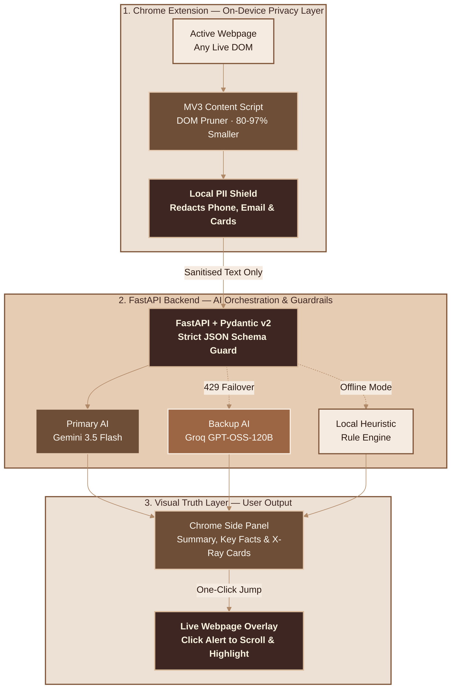

# GlassWeb
### Site-Agnostic AI Browser Co-Pilot & Dark-Pattern X-Ray

**Team API IN REST** • **wHACKiest 2026** • **Track 2: Beyond the Browser**

---

## The Problem
Over **800M+ Indian internet users** waste 30–45 minutes bouncing across 8–15 open tabs to compare insurance policies, scholarship portals, SaaS plans, or rental agreements—and still get caught by buried fine print and the **13 deceptive dark patterns** banned under India's CCPA guidelines.

Existing tools fall short:
* **Shopping extensions** (BuyHatke, Honey) rely on hardcoded scrapers and go blind outside e-commerce.
* **AI sidebars** (ChatGPT, Copilot) are passive, single-tab chat windows that cannot highlight traps live on the page.
* **Enterprise RPA** (UiPath) depends on brittle selectors that break on every UI update.

## The Solution: GlassWeb
**GlassWeb** is a privacy-first Chrome Side Panel co-pilot that reasons over **any live DOM on the web** with zero site-specific scrapers:

1. **Cross-Tab Decision Matrix** — Synthesises hidden fees, eligibility rules, and true costs across multiple open tabs into one structured comparison table.
2. **Live Dark-Pattern & Fine-Print X-Ray** — Flags CCPA dark patterns (*Subscription Traps, Drip Pricing, False Urgency, Basket Sneaking, Hidden Clauses*) and highlights the exact clause directly on the webpage with one-click scroll-to-trap navigation.
3. **Human-in-the-Loop Action Agent** — Executes multi-step filtering and form filling from English/Hinglish prompts while pausing at a mandatory user approval gate before any submission.
4. **On-Device Privacy Shield** — Prunes **80–97% of raw HTML boilerplate** and redacts PII (emails, Indian mobile numbers, card patterns) locally inside the browser before calling the backend.

---

## Live Stage-1 Prototype Preview

> *Live scan on Spotify Premium India: **97% DOM pruned locally**, structured promotional vs. regular pricing extracted via `gemini-flash-lite-latest`, and auto-renewal catch highlighted directly on the page.*

---

## System Architecture

